# Deus Orchestrator v2 — пайплайн, зависимости и правила

> Полное описание того, как работает оркестратор в `agentic-orchestrator-v2-deus`, от запуска CLI до финального отчёта. Основано на исходниках `src/orchestrator.ts`, `src/dag/engine.ts`, `src/kb/*`, `src/state/*`, `.opencode/agents/` и плагина мониторинга.

---

## 1. Общая архитектура

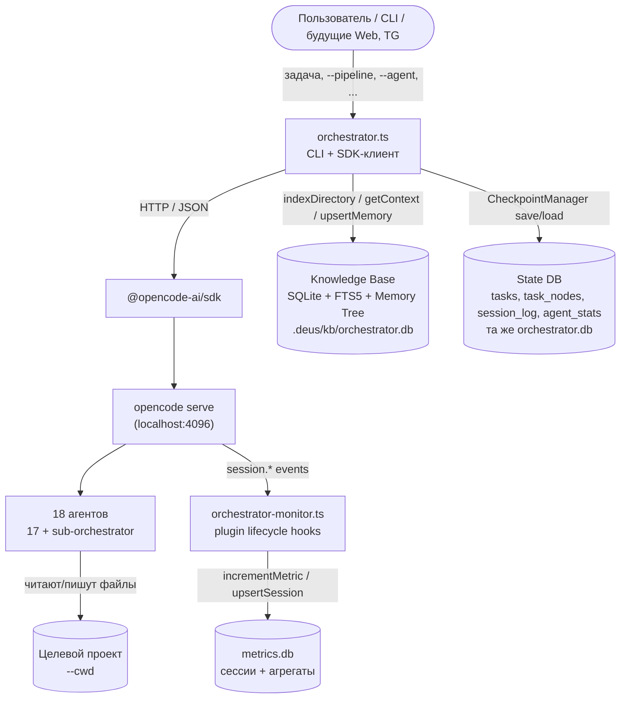

### Ключевые компоненты

| Компонент | Файл | Ответственность |
|-----------|------|-----------------|
| `orchestrator.ts` | `src/orchestrator.ts` | CLI, разбор аргументов, запуск сервера, диспетчеризация режимов, polling сессий, сохранение отчётов |
| `opencode-client.ts` | `src/opencode-client.ts` | Синглтон `@opencode-ai/sdk`, создание/отправка/чтение сессий |
| `DAGEngine` | `src/dag/engine.ts` | Выполнение DAG графа: валидация, Kahn's algorithm, retries, fallback на context-limit |
| `TaskManager` | `src/state/task-manager.ts` | CRUD задач и нод, логирование сессий, статистика по агентам |
| `StateDatabase` | `src/state/schema.ts` | Схема SQLite для `tasks`, `task_nodes`, `session_log`, `agent_stats` |
| `RagKbProvider` | `src/kb/rag-provider.ts` | Фасад KB: индексация, поиск, контекст, memory tree, smart context |
| `CheckpointManager` | `src/kb/checkpoint.ts` | Сохранение/загрузка чекпоинтов через Memory Tree + tasks |
| `orchestrator-monitor` | `.opencode/plugins/orchestrator-monitor.ts` | Хуки `session.created/updated/status/error/deleted` → метрики |

---

## 2. Поток от запуска до результата

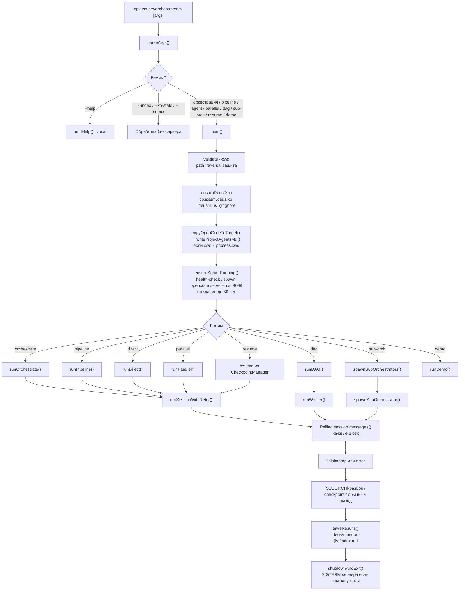

---

## 3. Режимы запуска

| Режим | Команда | Что делает |
|-------|---------|------------|
| `orchestrate` (default) | `"задача"` или `--orchestrate` | LLM-дирижёр сам выбирает пайплайн и агентов |
| `pipeline` | `--pipeline build "задача"` | Жёстко заданная последовательность агентов (см. PIPELINES) |
| `direct` | `--agent implementer-builder "задача"` | Один агент |
| `parallel` | `--parallel "задача1" "задача2"` | Несколько независимых сессий параллельно |
| `dag` | `--dag graph.json` | Выполнение DAG графа через `DAGEngine` |
| `sub-orch` | `--sub-orch domains.json` | Параллельные sub-orchestrators по доменам |
| `resume` | `--resume [checkpointId]` | Возобновление из чекпоинта |
| `index` | `--index ./project` | Принудительная индексация в KB |
| `kb-stats` | `--kb-stats` | Статистика KB |
| `metrics` | `--metrics` | Метрики из `metrics.db` |
| `demo` | `--demo` | Три демо-сценария |

---

## 4. Orchestrate-режим: от задачи к dispatch

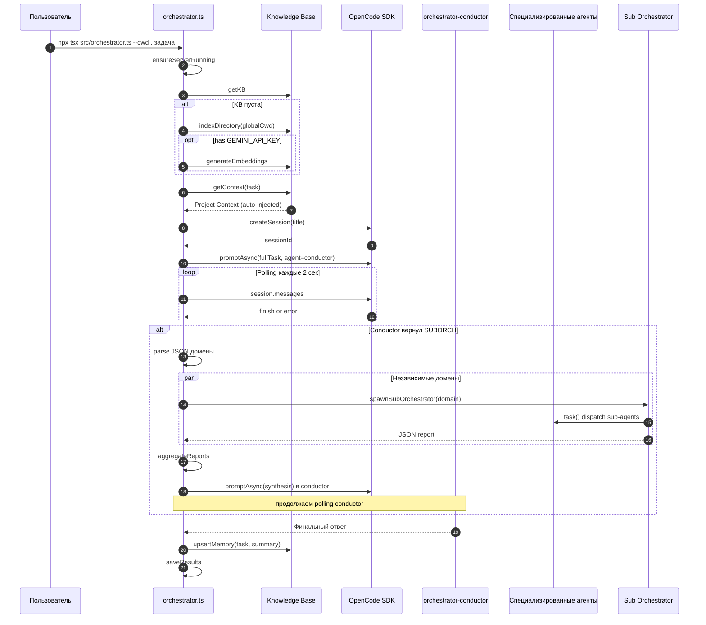

### Что делает conductor (`.opencode/agents/orchestrator-conductor.md`)

1. **Классифицирует** домен: software / content / data / design.
2. **Выбирает pipeline** по сложности:
   - trivial → direct implementer/debug
   - simple → `build`
   - standard → `build-review`
   - high-stakes (auth/payments/security) → `full-cycle` с pro-агентами
   - bug → `debug-fix`
   - multi-domain >8 агентов → `sub-orch`
3. **Диспатчит** через `task()` (sub-agents не имеют общей памяти — контекст копируется целиком).
4. **Не выполняет работу сам** — нет прав `edit/bash/glob/grep`.
5. **Контролирует контекст**: при переполнении выводит `[CHECKPOINT]` или `[SUBORCH]`.

---

## 5. Static pipeline: как выполняются шаги

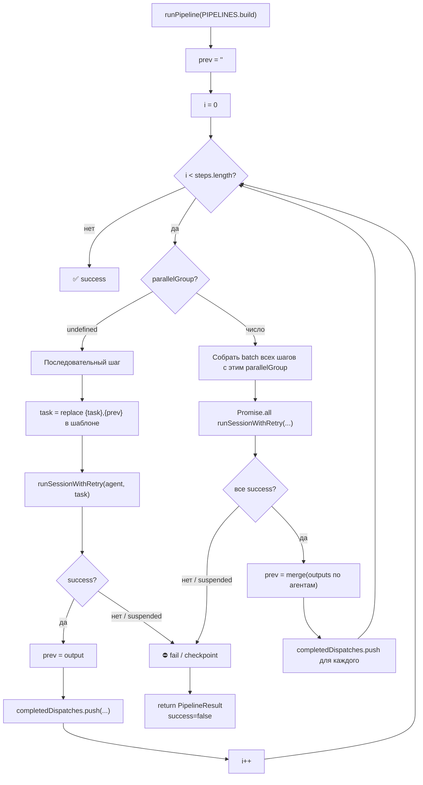

### Статические пайплайны (константа `PIPELINES`)

| Пайплайн | Шаги |
|----------|------|
| `build` | researcher → architect → implementer → reviewer → qa |
| `build-pro` | researcher → architect-pro → implementer → reviewer-pro → qa |
| `full-cycle` | researcher → architect-pro → reviewer-pro → implementer → reviewer-pro → qa → doc |
| `audit` | security → code-reviewer → reviewer |
| `debug` | researcher → debug → implementer → qa |
| `docs` | researcher → content-writer → reviewer |
| `parallel-audit` | security ∥ code-reviewer ∥ reviewer |
| `parallel-research` | 3 researcher-explorer параллельно |
| `parallel-review` | security ∥ code-reviewer ∥ reviewer (на одном контексте) |
| `content` | researcher → content-writer → reviewer |
| `data` | researcher → data-analyst → reviewer |
| `design` | researcher → ux-designer → reviewer → implementer |
| `plan` | researcher → architect |
| `research` | researcher |

Переменные в шаблонах:
- `{task}` — исходная задача (или `prev`, если предыдущего контекста нет).
- `{prev}` — вывод предыдущего шага (или merge параллельной группы).

---

## 6. DAG-режим

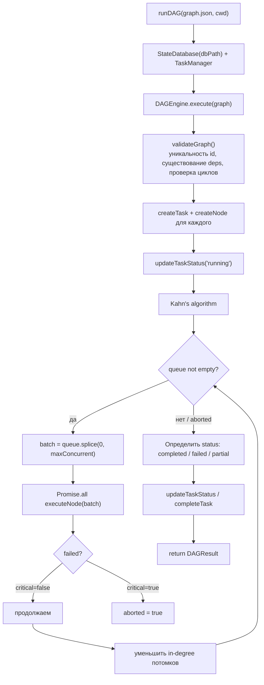

### Формат `TaskGraph`

```ts
interface TaskGraph {
  id: string;
  nodes: TaskNodeDefinition[];
  config: { maxConcurrent: number; maxCost: number; defaultTimeout: number };
}

interface TaskNodeDefinition {
  id: string;
  agent: string;
  prompt: string;        // шаблоны {{nodeId.result}} / {{nodeId.error}} / {{nodeId.summary}}
  dependsOn: string[];
  retry?: number;        // default 2
  fallbackAgent?: string; // при context-limit после исчерпания retries
  timeout?: number;      // default 300000
  critical?: boolean;    // default true
}
```

---

## 7. Sub-Orchestrator: распараллеливание по доменам

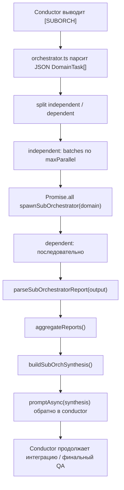

### `DomainTask`

```ts
interface DomainTask {
  domain: string;
  subTask: string;
  kbContext?: string;
  dependsOn?: string[];
}
```

### `SubOrchestratorReport`

```ts
{
  subOrchestratorId: string;
  status: "done" | "blocked" | "failed";
  summary: string;
  artifacts: string[];
  decisions: string[];
  blockers: string[];
  recommendations: string[];
  agentsUsed: number;
  contextUsedApprox?: number;
}
```

Константы:
- `SUB_ORCHESTRATOR_TIMEOUT_MS = 600_000` (10 мин).
- `SUB_ORCHESTRATOR_MAX_PARALLEL = 3`.
- `SUB_ORCHESTRATOR_DEFAULT_MAX_DEPTH = 2` (управляется `--max-depth`).

---

## 8. Жизненный цикл одной сессии

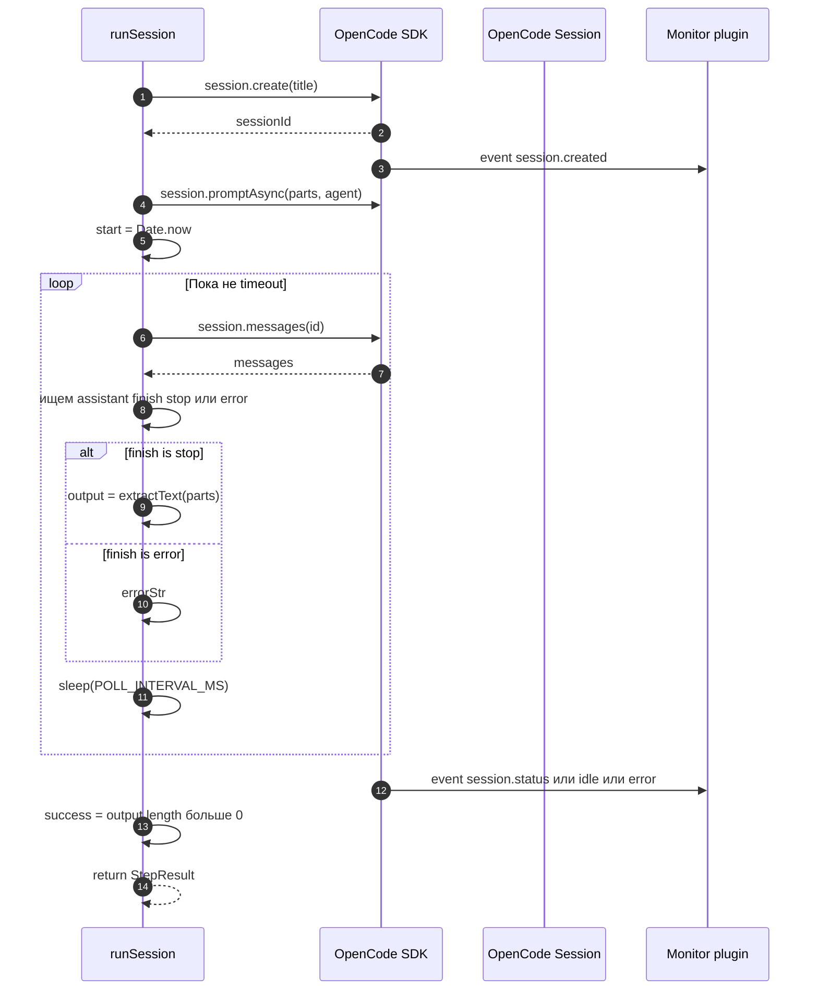

### Retry-политика

- `runSessionWithRetry`: **одна** повторная попытка при неуспехе (для pipeline/direct/orchestrate).
- `DAGEngine`: `retry` по умолчанию **2** (итого 3 попытки) с экспоненциальной задержкой `5s * 2^(attempt-1)`.
- Если в DAG ошибка context-limit и задан `fallbackAgent` — последняя попытка идёт с fallback-агентом.

### Таймауты

| Режим | Таймаут |
|-------|---------|
| `runSession` | `DEFAULT_TIMEOUT_MS = 30 * 60 * 1000` (30 мин) |
| `runWorker` / DAG-нода | `defaultTimeout = 300_000` (5 мин) или `node.timeout` |
| Sub-orchestrator | `SUB_ORCHESTRATOR_TIMEOUT_MS = 600_000` (10 мин) |
| Ожидание `opencode serve` | 60 итераций × 500 мс = 30 сек |

---

## 9. Knowledge Base: индексация и контекст

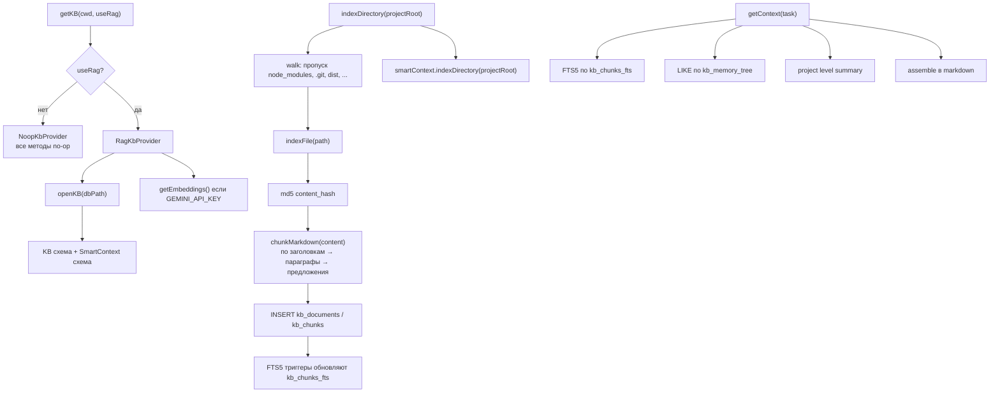

### Таблицы KB

| Таблица | Назначение |
|---------|------------|
| `kb_documents` | Проиндексированные файлы (path, content_hash) |
| `kb_chunks` | Семантические чанки (heading, level, content, token_count) |
| `kb_chunks_fts` | Виртуальная FTS5-таблица (`tokenize='porter unicode61'`) |
| `kb_embeddings` | Векторы Gemini `gemini-embedding-2`, 3072 dim |
| `kb_memory_tree` | Иерархические саммари: file/section/project/checkpoint |

### Smart Context Engine

Реализована в `src/kb/smart-context/`:
- `indexer.ts` — парсинг файлов, извлечение символов/импортов.
- `graph.ts` — Symbol Graph + Import Graph.
- `search.ts` — стратегии: BM25, path, import, symbol.
- `ranker.ts` — ранжирование с учётом категории запроса (bugfix/feature/refactor).
- `budget.ts` — сборка контекста с учётом лимита токенов.
- Используется через `KbProvider.searchCode(query, topN)`.

---

## 10. Checkpoint и auto-resume

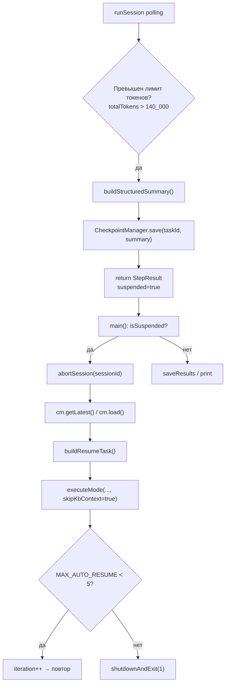

### Правила чекпоинтов

- Срабатывает при `> 140 000` токенов в одной сессии.
- Состояние сохраняется в SQLite: `completedDispatches` и `pendingDispatches` — в JSON-поле `tasks.graph`, саммари — в `kb_memory_tree` (`level='checkpoint'`).
- `MAX_AUTO_RESUME = 5` автоматических продолжений.
- После успешного resume старые чекпоинты обрезаются до 5 последних (`prune(5)`).
- Ручной resume: `--resume [checkpointId]` — последний, если id не указан.

---

## 11. Плагин мониторинга

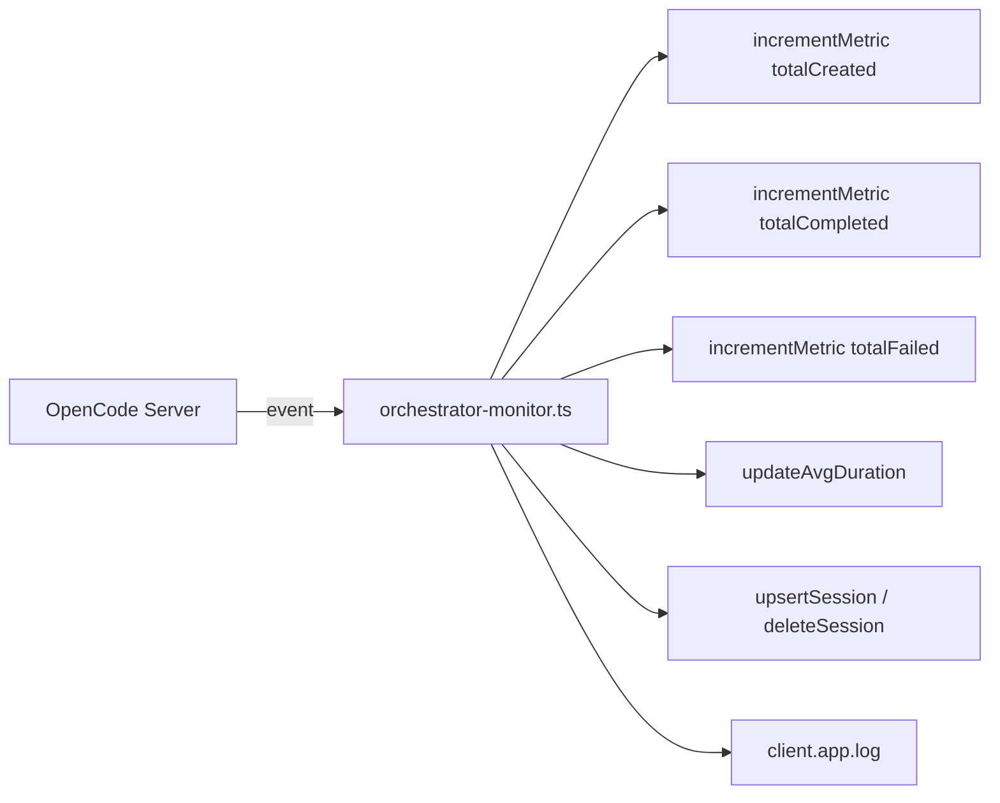

### Обрабатываемые события

| Событие | Действие |
|---------|----------|
| `session.created` | `totalCreated++`, `activeSessions++`, `upsertSession(status=active)` |
| `session.updated` | обновление title / directory |
| `session.status` | `idle` → `totalCompleted++`, `activeSessions--`, средняя длительность |
| `session.error` | `totalFailed++`, пометка сессии failed |
| `session.deleted` | удаление из активных, `deleteSession` |

### Метрики (`metrics.db`)

| Ключ | Смысл |
|------|-------|
| `totalCreated` | Всего создано сессий |
| `totalCompleted` | Успешно завершено |
| `totalFailed` | Упало с ошибкой |
| `activeSessions` | Активных сейчас |
| `avgDurationMs` | Средняя длительность |

---

## 12. Правила, условия и зависимости

### Общие правила оркестрации

| # | Правило | Где реализовано |
|---|---------|-----------------|
| 1 | Conductor **не выполняет работу сам** — только `task()`/`skill()` | `.opencode/agents/orchestrator-conductor.md` |
| 2 | Sub-agents **stateless** — контекст копируется целиком в каждый `task()` | conductor.md + sub-orchestrator.md |
| 3 | Для high-stakes (auth/payments/security) используются pro-агенты | conductor.md, `opencode.json` |
| 4 | При переполнении контекста — `[CHECKPOINT]` или `[SUBORCH]` | conductor.md, `runSession` |
| 5 | Pipeline прерывается при первой ошибке (fail-fast) | `runPipeline` |
| 6 | DAG-нода может быть `critical=false` — тогда падение не останавливает граф | `DAGEngine.execute` |
| 7 | Path traversal защита: `--cwd` должен быть внутри `process.cwd()` | `isValidTargetPath` |
| 8 | Сервер `opencode serve` авто-стартует, если не запущен | `ensureServerRunning` |

### Модели агентов

| Агент | Модель (фактически в `opencode.json`) | Назначение |
|-------|---------------------------------------|------------|
| `orchestrator-conductor` | `opencode-go/deepseek-v4-flash` | Дирижёр |
| `architect-planner-pro` | `opencode-go/deepseek-v4-pro` | Сложная архитектура |
| `reviewer-critic-pro` | `opencode-go/deepseek-v4-pro` | High-stakes ревью |
| Остальные 15 | `opencode-go/deepseek-v4-flash` | Исполнители |

> В README/ARCHITECTURE указано, что conductor работает на pro-модели, но в актуальном `.opencode/opencode.json` conductor настроен на `deepseek-v4-flash`. Pro-агенты только `architect-planner-pro` и `reviewer-critic-pro`.

### Зависимости данных

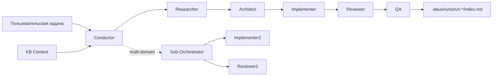

### Зависимости компонентов кода

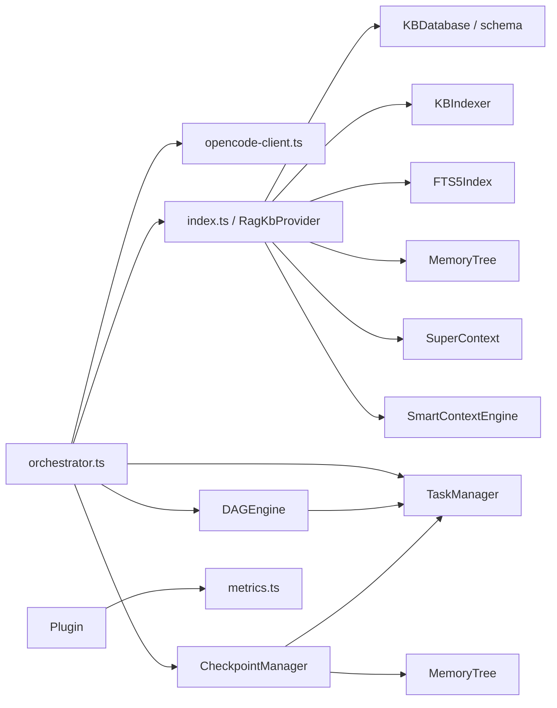

---

## 13. Структура артефактов

После каждого прогона создаётся директория:

```
.deus/
├── .gitignore              # игнорирует всё внутри
├── kb/
│   ├── orchestrator.db     # KB + State
│   └── metrics.db          # метрики мониторинга
└── runs/
    └── run-2026-07-03T09-21-46/
        ├── index.md        # сводная таблица
        ├── researcher-explorer.md
        ├── architect-planner.md
        ├── implementer-builder.md
        └── ...
```

---

## 14. Где смотреть исходники

| Логика | Файл |
|--------|------|
| CLI, аргументы, режимы | `src/orchestrator.ts` |
| SDK-клиент | `src/opencode-client.ts` |
| DAG-движок | `src/dag/engine.ts`, `src/dag/types.ts` |
| State/чекпоинты | `src/state/schema.ts`, `src/state/task-manager.ts`, `src/kb/checkpoint.ts` |
| Knowledge Base | `src/kb/rag-provider.ts`, `src/kb/indexer.ts`, `src/kb/search.ts`, `src/kb/super-context.ts`, `src/kb/schema.ts` |
| Smart Context | `src/kb/smart-context/index.ts` |
| Memory Tree | `src/kb/memory-tree.ts` |
| Мониторинг | `.opencode/plugins/orchestrator-monitor.ts`, `src/metrics.ts` |
| Промпты агентов | `.opencode/agents/orchestrator-conductor.md`, `.opencode/agents/sub-orchestrator.md` |
| Custom tool `search_code` | `.opencode/tools/search-code.ts` |
| Конфиг моделей | `.opencode/opencode.json` |
| Планы развития / статус | `CONTEXT-OVERFLOW-PLAN.md`, `SCALING-PLAN.md`, `REPAIR-PLAN.md` |

---

> Актуально для версии `2.0.0` (`package.json`). Если структура кода изменится — обнови этот файл вместе с ней.
